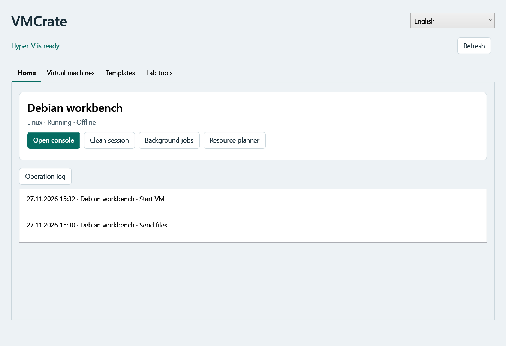

# VMCrate

[](https://github.com/poikilometis/VMCrate/actions/workflows/ci.yml)
[](#requirements)
[](#build-and-test)
[](LICENSE)

**Reusable Hyper-V labs from a native Windows desktop.** Prepare a Windows or Linux template, launch an isolated test VM, and reset or discard the session when you're done.

[Download](https://github.com/poikilometis/VMCrate/releases) · [Quick start](#quick-start) · [Features](#features) · [Documentation](#documentation) · [Contributing](CONTRIBUTING.md)



*VMCrate Home with example activity from an Offline VM.*

## Features

| Workflow | What VMCrate does |
| --- | --- |
| Templates | Find official install media, verify checksums, import Generation 2 VHDX files, and test new template revisions before publication. The wizard can generate a Kali amd64 setup disc. |
| Isolation | Start with networking disconnected. Inspect Hyper-V and guest observations, use a scoped update proxy for a builder, and pass files through a read-only inbox or a separate Offline receiver. |
| Recovery and portability | Reset a clone, capture recovery points, back up a stopped lab, and test that the backup boots in an independent Offline copy. |
| Lab operations | Resume work from Home. Use the resource planner, durable background jobs, pinned starter recipes, and Windows and Linux update inventories. |
| Team queue | Deploy and operate approved lab recipes on a dedicated Hyper-V host. Mutual TLS maps each operator to a separate workspace. |

The interface supports 15 languages. Optional AI integrations use a signed-in CLI to draft blueprints and explain selected findings. [AI workflows](docs/assistant.md)

## Quick start

### Requirements

- Windows 11 x64 with Hyper-V, its PowerShell management tools, and hardware virtualization enabled.
- An account authorized to manage Hyper-V and a local workspace with room for ISOs and virtual disks.
- Windows Sandbox is optional. Use the x64 .NET 10 SDK to build from source.

### Run your first VM

1. Download the Windows x64 ZIP and its `.sha256` file from [GitHub Releases](https://github.com/poikilometis/VMCrate/releases), or [build a ZIP locally](#build-and-test). Use `Get-FileHash` to compare the ZIP's SHA-256 with the checksum file. Extract the whole package, then run `VMCrate.exe`.
2. Choose a workspace. Open **Home → First VM** to select an existing template, import a prepared Generation 2 VHDX, or build a template from an [official image](docs/operations.md#build-a-versioned-template).
3. Choose **Create and start Offline VM**, then set its name and resources. VMCrate opens VMConnect when the VM is running. Use **Clean session** for disposable work or **Reset disk** to return a stopped clone to its base template.

## Build and test

```powershell
dotnet build VMCrate.slnx -c Release
dotnet run --project src/VMCrate.Desktop -c Release --no-build
dotnet run --project tests/VMCrate.Tests -c Release --no-build
powershell -NoProfile -NonInteractive -File tests/HyperV.Tests.ps1
```

With the matching x64 Desktop and ASP.NET Core runtimes installed, run `pwsh -NoProfile -File scripts/New-Release.ps1`. The script writes the ZIP and SHA-256 file to `artifacts/releases`.

The [compatibility log](docs/compatibility.md) records live Hyper-V results and release signature instructions. The [security model](SECURITY.md) explains host and guest isolation assumptions.

## Documentation

| Start here | Topics |
| --- | --- |
| [Host and lab operations](docs/operations.md) | Template builds, proxy setup, disk recovery, and VM transfer |
| [Workflows and examples](docs/workflows.md) | Blueprints, recipes, CLI validation, and offline kits |
| [Team queue setup](docs/remote-queue.md) | Host configuration, certificates, and operator workspaces |
| [Architecture](docs/architecture.md) | Workspace storage, Hyper-V adapter, and lifecycle invariants |
| [Contributing](CONTRIBUTING.md) | Development conventions and Hyper-V acceptance |
| [Localization](docs/localization.md) | Language catalogs and translation checks |

VMCrate is available under the [MIT License](LICENSE). See [Security reporting](SECURITY.md#reporting) for disclosure.
