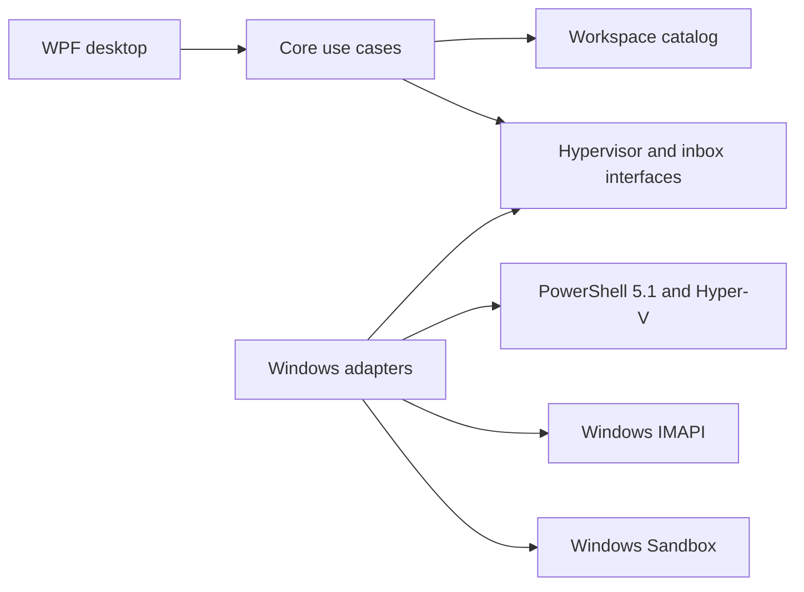

# Architecture

- `VMCrate.Core` owns VM and template records, validates inputs, and coordinates operations. It contains no references to WPF or Hyper-V.
- `VMCrate.Windows` implements the two platform interfaces. It sends JSON over stdin to a fixed set of Windows PowerShell scripts. Hyper-V operation results return as JSON on stdout. Windows IMAPI writes UDF images for inbox transfers. The Sandbox adapter exports and launches an offline WSB configuration.
- `VMCrate.Desktop` is the composition root. It handles UI state, confirmation dialogs and localization, and dispatches file and Hyper-V operations off the UI thread.

## Ownership and storage

The workspace holds `state.json`, `templates/<id>/base.vhdx`, and `machines/<id>/` for each VM's configuration, disks and inbox. Display names never determine paths. The catalog updates under an exclusive workspace lock with an atomic replace. Schema 4 adds pending VM creation requests. Version 1 through 3 catalogs migrate on the next write. Schema 5 records operation evidence, archived disposable sessions and template lineage. Schema 6 adds named disk recovery points and a persistent restore plan. Schema 7 records the transfer identity and a prepared disk for recoverable registration. Successful writes retain the previous state in `state.previous.json`. Hyper-V resources are verified by both generated name and workspace ownership marker.

Creation records VM ownership before touching Hyper-V. Recovery rechecks ownership and registration before continuing a pending create. A fully configured VM is acknowledged with its disk intact. A retry that still needs to create a VM allocates a new disk and lists the prior one for review. Disk reset changes the drive attachment to a new differencing disk before attempting to delete the old disk. Unmounted artifacts left after a failed operation are collected during VM removal. Capturing a template copies and validates the standalone VHDX before recording it. Cold transfer uses a detached VHDX copy with a SHA-256 manifest, then uses the provisioning journal to re-register the installed guest as a new Offline VM.

Schema 8 records build proxy observations and preferred template revisions. It extends prepared-disk recovery to restored lab VMs with verified parent disks. Lab restore checks the entire backup before provisioning. It rebinds each verified working disk to its copied parent and journals registration before touching Hyper-V. The manifest fingerprint and source VM ID identify a retry. The destination workspace scopes the recreated private segments.

VMs created individually share a private switch per data directory when configured to use private networking. Blueprint switches are scoped to the workspace, blueprint and named network segment. The adapter verifies the type and ownership marker of each switch before using it. You can remove unused switches in Hyper-V Manager after removing or disconnecting their VMs.

## Blueprint and session lifecycle

The planner validates the entire blueprint and compares registered VMs with the catalog and host before provisioning. It holds the workspace lock across deployment. If a VM fails to provision, opening the same blueprint resumes from the catalog records and confirmed host state.

Disposable sessions are eligible for automatic cleanup only after Hyper-V confirms their first start and the app records it. A refresh confirms that the VM is off. The adapter checks ownership and power state again before deletion. Cleanup failures stay visible in the UI and retain the catalog record.

## Builds and update networking

The build coordinator records a stable VM ID and a stage before provisioning. ISO copies are named by SHA-256 and validated before use. The imported or captured template references its revision and creation time. Storage maintenance checks the catalog and Hyper-V media attachments before deleting a cached ISO. The official image registry describes publisher pages and HTTPS checksum feeds. Downloads write to a partial file, re-hash on completion and publish the checked ISO to the same cache.

Updates mode validates an existing internal WinNAT switch and applies IPv4 and IPv6 policy while the owned builder adapter is detached. Startup verifies the current rules and switch against the catalog. Kali setup disc generation reads ISO 9660 and Joliet entries from the verified installer, reuses the matching EFI loader, and writes an extra answer-file initramfs through IMAPI. Capturing a build detaches the network and ejects its inbox. Proxy diagnostics check the host route, adapter policy and TCP connectivity. A PowerShell Direct command or a Linux probe delivered on the read-only inbox tests the guest path to a fixed repository.

## Assistant integration and transport

Core composes typed diagnostic observations and validates evidence references and blueprint drafts. The control beside each cited identifier opens the original measurement. Windows launches the selected signed-in CLI with the reviewed prompt on stdin. The desktop owns the request preview and model response presentation. Project archives carry a blueprint, pinned hashes and optionally the immutable template disks. Archive import verifies each new disk and commits the catalog after validation.

## Remote host

`VMCrate.Host` serves the queue with Kestrel mutual TLS. Each client certificate maps to one workspace and a catalog of approved recipes with pinned template hashes. Endpoints accept recipe IDs, action codes and stable request IDs. A single worker uses the existing Hyper-V adapter while the queue journal persists state transitions. Core holds the workspace lock for template verification and execution of a pinned recipe.

## Boot checks

Start checks the expected virtual switch, network adapter guards, guest file copy and key-value exchange, checkpoint settings, media layout and disk parent. A change made directly in Hyper-V Manager can cause the start check to fail. These checks inspect host configuration and should be complemented by guest connectivity testing for deployments that rely on isolation.

A recovery point copies stopped working disks while holding read handles. Restore stages verified replacements and records the old and new paths before any attachment change. An interrupted plan prevents affected VM starts through VMCrate until the adapter confirms every replacement. Disk reset preserves VM hardware, firmware and TPM state. VM removal and a new clone provide a new VM identity. Keep base images free of disk encryption bound to the builder VM's TPM.
